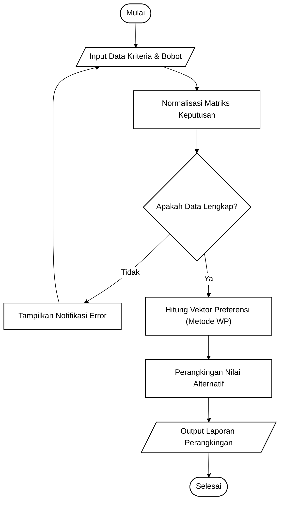
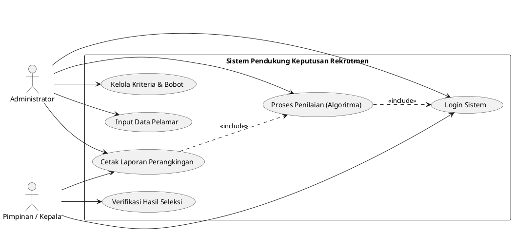
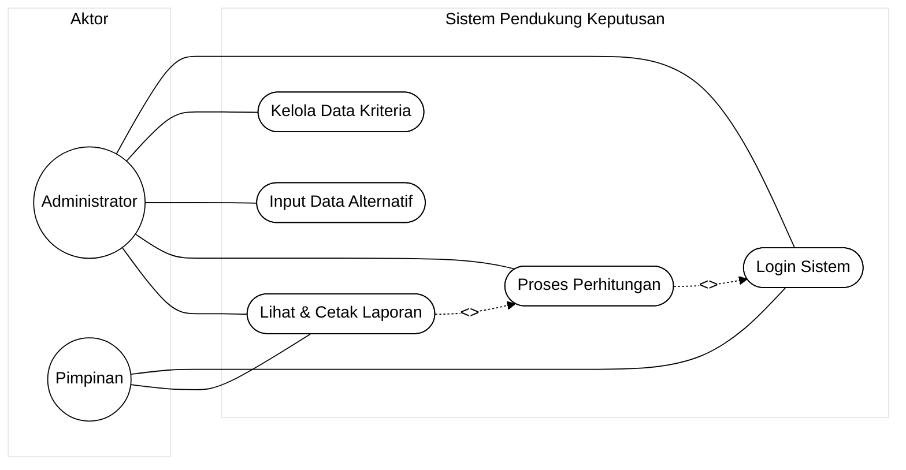
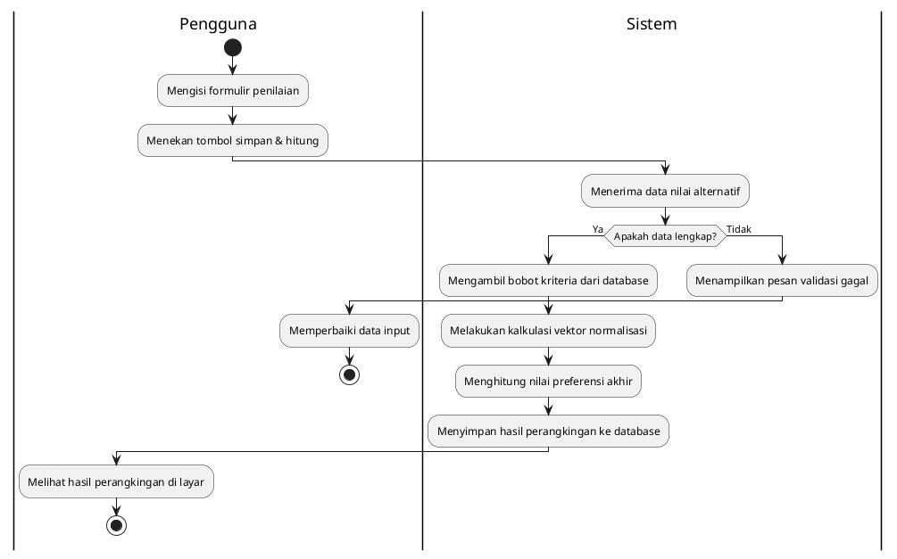
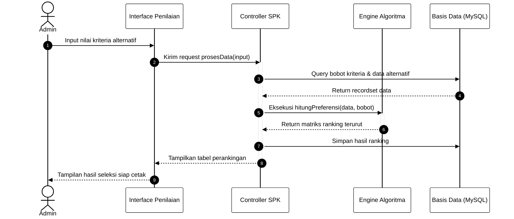
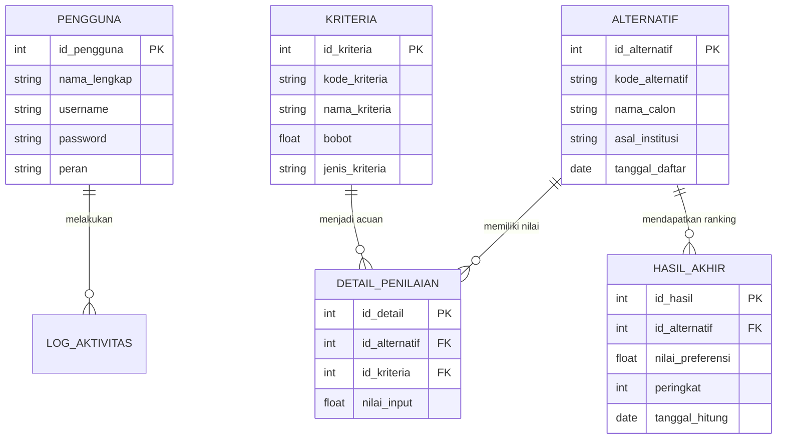
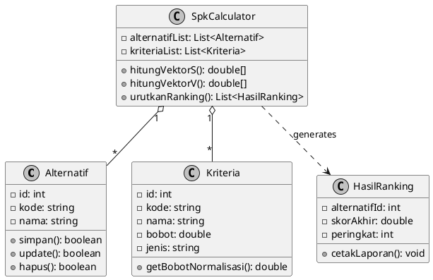
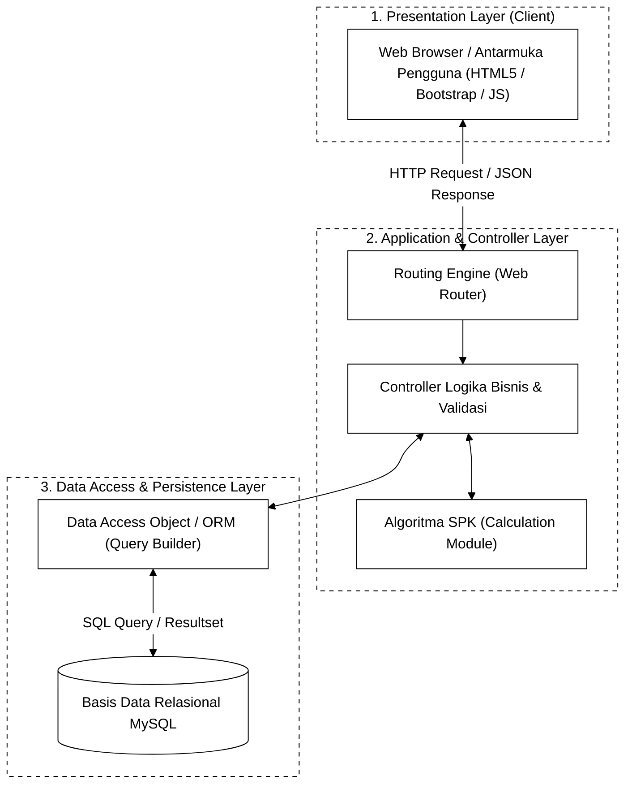

# SOP PEMBUATAN DIAGRAM TEKNIS SKRIPSI INFORMATIKA
## STANDARISASI DIAGRAM-AS-CODE (MERMAID, PLANTUML, DRAW.IO) & VISUAL ZERO-DEFECT

**Document ID:** SOP-DIAGRAM-002  
**Version:** 2.0 (Enhanced Technical Specification)  
**Status:** MANDATORY & STRICT ENFORCEMENT  
**Scope:** Seluruh AI Agent dan pembuatan diagram sistem, ERD, UML, flowchart, dan arsitektur pada naskah skripsi.  

---

## 1. TUJUAN DAN PRINSIP UTAMA
File ini menetapkan standar teknis pembuatan diagram skripsi informatika agar **bebas cacat sintaks (*zero-defect*)**, **terbaca sempurna saat dicetak monokrom**, dan **merefleksikan sistem nyata tanpa komponen fiktif**.

```text
+--------------------------------------------------------------------------+
| 1. ACCURATE   : Wajib sesuai arsitektur code dan database faktual.       |
| 2. MONOCHROME : Garis hitam solid, teks hitam, latar dan isi putih murni.|
| 3. CODE-BASED : Dibuat menggunakan sintaks teknis resmi (Mermaid/PlantUML|
|                 /Draw.io XML) yang dapat di-compile tanpa error.         |
| 4. NO SHADOW  : Bebas warna gradasi, bayangan (shadow), glow, dan 3D.    |
| 5. ACADEMIC   : Tipografi Times New Roman, ukuran proporsional (10-12 pt)|
|                 dan lebar maksimal 14 cm (pas di margin Word 4-4-3-3).   |
+--------------------------------------------------------------------------+
```

---

## 2. STANDAR BAHASA TEKNIS PEMROGRAMAN DIAGRAM (*DIAGRAM-AS-CODE*)

AI Agent **WAJIB** menggunakan salah satu dari 3 bahasa teknis berikut saat memprogram diagram:

1. **Mermaid.js (`mermaid`)**: Bahasa standar utama untuk preview langsung di Markdown, chat, dan diekspor ke SVG/PNG.
2. **PlantUML (`puml`)**: Standar formal rekayasa perangkat lunak internasional untuk pemodelan UML kompleks.
3. **Draw.io XML / Draw.io CSV**: Format visual interaktif jika pengguna memerlukan pengeditan manual via aplikasi desktop Draw.io.

---

## 3. KONFIGURASI TEMA MONOKROM BAKU (*ZERO-DEFECT PALETTE*)

### 3.1 Direktif Wajib Mermaid.js
Setiap kode Mermaid **WAJIB** diawali dengan direktif tema monokrom berikut:

```text
%%{init: {
  'theme': 'base',
  'themeVariables': {
    'primaryColor': '#ffffff',
    'primaryTextColor': '#000000',
    'primaryBorderColor': '#000000',
    'lineColor': '#000000',
    'secondaryColor': '#ffffff',
    'tertiaryColor': '#ffffff',
    'fontFamily': 'Times New Roman, serif',
    'fontSize': '12px'
  }
}}%%
```

### 3.2 Direktif Wajib PlantUML
Setiap diagram PlantUML **WAJIB** menyertakan parameter `skinparam` monokrom tanpa bayangan:

```plantuml
@startuml
skinparam monochrome true
skinparam shadowing false
skinparam defaultFontName "Times New Roman"
skinparam defaultFontSize 12
skinparam backgroundColor #FFFFFF
skinparam ArrowColor #000000
skinparam BorderColor #000000
skinparam BoxPadding 10
skinparam ParticipantPadding 15
skinparam RoundCorner 0
@enduml
```

---

## 4. TEMPLATE SINTAKS BAKU PER JENIS DIAGRAM SKRIPSI

### 4.1 Flowchart / Diagram Alir Algoritma (Standar ANSI/ISO)
Flowchart digunakan untuk menjelaskan alur sistem atau tahapan kalkulasi metode/algoritma di BAB III dan BAB IV.

* **Simbol Standar:**
  - Oval / Rounded: Terminator (Mulai / Selesai)
  - Persegi Panjang: Proses Komputasi
  - Belah Ketupat: Keputusan / Percabangan (*Decision*)
  - Jajar Genjang: Input / Output Data

* **Kode Mermaid Baku:**


---

### 4.2 Use Case Diagram (UML)
Menggambarkan interaksi fungsional antara aktor dengan sistem di BAB III.

* **Aturan Kritis:**
  - Aktor **selalu berada di luar** *System Boundary*.
  - Nama use case diawali kata kerja tindakan (contoh: *Mengelola Data*, *Melakukan Penilaian*).
  - Relasi `<<include>>` untuk fungsi wajib, `<<extend>>` untuk fungsi opsional/kondisional.

* **Kode PlantUML Baku:**


* **Kode Mermaid Baku:**


---

### 4.3 Activity Diagram (UML)
Menjelaskan alur aktivitas proses bisnis secara runtut antara aktor dan sistem (dengan swimlane).

* **Kode PlantUML Baku (Dengan Swimlane):**


---

### 4.4 Sequence Diagram (UML)
Menjelaskan pertukaran pesan antar-objek/komponen berdasarkan urutan waktu.

* **Kode Mermaid Baku:**


---

### 4.5 Entity-Relationship Diagram (ERD / Relasi Tabel Basis Data)
ERD wajib menggambarkan skema database aktual sesuai migration atau SQL script.

* **Aturan Kritis:**
  - Cantumkan nama tabel, primary key (`PK`), foreign key (`FK`), serta tipe data.
  - Kardinalitas relasi menggunakan notasi *Crow's Foot*:
    - `||--||` : One-to-One
    - `||--o{` : One-to-Many
    - `}|--o{` : Many-to-Many (wajib dipecah lewat tabel asosiasi)

* **Kode Mermaid Baku:**


---

### 4.6 Class Diagram (UML)
Menampilkan struktur kelas perangkat lunak, atribut, method, dan keterhubungannya di BAB III.

* **Kode PlantUML Baku:**


---

### 4.7 Arsitektur Sistem (Layered Architecture)
Menunjukkan arsitektur perangkat lunak dari sisi antarmuka, routing, server logika, hingga database.

* **Kode Mermaid Baku:**


---

## 5. ATURAN ANTI-CACAT SINTAKS (*ZERO-DEFECT SYNTAX RULES*)

Agar diagram tidak mengalami error saat di-*compile* atau rusak saat diekspor, patuhi 7 aturan ketat berikut:

1. **Wajib Menggunakan Tanda Petik pada Label Khusus**:
   - *Salah:* `A(Proses (Normalisasi)) --> B` (Error karena kurung di dalam kurung).
   - *Benar:* `A["Proses (Normalisasi)"] --> B` (Aman dari benturan sintaks).
2. **Hindari Garis Menyilang (*Line Crossing Prevention*)**:
   - Gunakan arah `TD` (Top-to-Bottom) untuk diagram alir sekuensial dan `LR` (Left-to-Right) untuk Use Case.
   - Jangan membuat tautan balik yang membelah diagram jika bisa menggunakan simpul konektor (*Connector node*).
3. **Pemisahan Teks Panjang Menggunakan Baris Baru**:
   - Batasi panjang teks dalam satu kotak simpul maksimal 4-5 kata per baris. Gunakan `\n` atau `<br/>` untuk memecah baris.
4. **Semantik Aktor & Boundary yang Valid**:
   - Aktor manusia tidak boleh diletakkan di dalam kotak sistem (*System Boundary*).
5. **Kardinalitas Basis Data yang Logis**:
   - Dilarang membuat relasi `Many-to-Many` (`M:N`) langsung tanpa tabel perantara (*junction table*) pada rancangan fisik ERD.
6. **Proporsi Skala Cetak (Print Dimensions)**:
   - Lebar maksimum diagram saat ditempelkan ke Microsoft Word adalah **14 cm** (agar tidak melanggar margin kiri 4 cm dan kanan 3 cm kertas A4).
   - Tinggi diagram tidak boleh melebihi **20 cm** agar tidak memicu pemotongan halaman secara liar.
7. **Resolusi Ekspor**:
   - Format wajib: **Vektor SVG** (pilihan utama) atau **PNG monokrom minimum 300 DPI**.

---

## 6. PENAMAAN BERKAS & LOKASI PENYIMPANAN
Seluruh diagram yang dihasilkan wajib disimpan pada folder:  
`ASSETS/DIAGRAM/`

Format penamaan berkas:
- Flowchart Algoritma : `diagram_3_1_flowchart_algoritma.[puml/mmd/svg/png]`
- Use Case Diagram    : `diagram_3_2_use_case.[puml/mmd/svg/png]`
- Activity Diagram    : `diagram_3_3_activity_penilaian.[puml/mmd/svg/png]`
- Sequence Diagram    : `diagram_3_4_sequence_kalkulasi.[puml/mmd/svg/png]`
- Class Diagram       : `diagram_3_5_class_diagram.[puml/mmd/svg/png]`
- Entity Relationship : `diagram_3_6_erd.[puml/mmd/svg/png]`
- Arsitektur Sistem   : `diagram_3_7_arsitektur_sistem.[puml/mmd/svg/png]`

---

## 7. QUALITY CONTROL CHECKLIST SEBELUM DIAGRAM MASUK NASKAH

Sebelum diagram dimasukkan ke dalam draf naskah skripsi, agent wajib memverifikasi:
- [ ] **Sintaks Valid**: Tidak ada pesan error parser pada editor Mermaid/PlantUML.
- [ ] **Warna Monokrom Murni**: Latar putih (#FFFFFF), garis hitam solid (#000000), tanpa bayangan (*no shadows*).
- [ ] **Kesesuaian Teks**: Setiap entitas, tabel, field, dan aktor memiliki kesamaan nama 100% dengan teks di [CONTEXT_SKRIPSI.txt](CONTEXT_SKRIPSI.txt).
- [ ] **Nomor & Caption**: Memiliki caption resmi di bawah gambar (Contoh: *Gambar 3.1 Flowchart Metode Weighted Product*).
- [ ] **Paragraf Penjelas**: Terdapat minimal satu paragraf narasi analitis di dalam teks skripsi yang membahas diagram tersebut.
