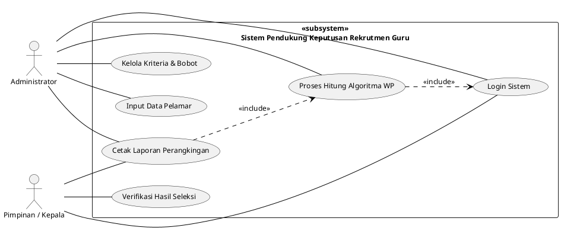
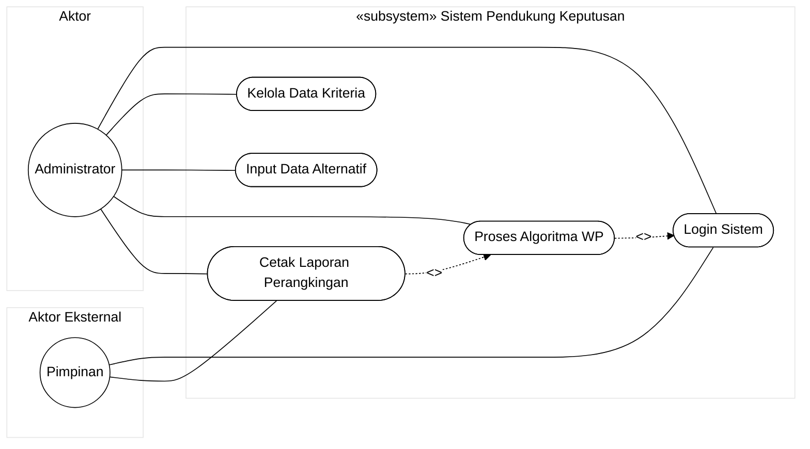
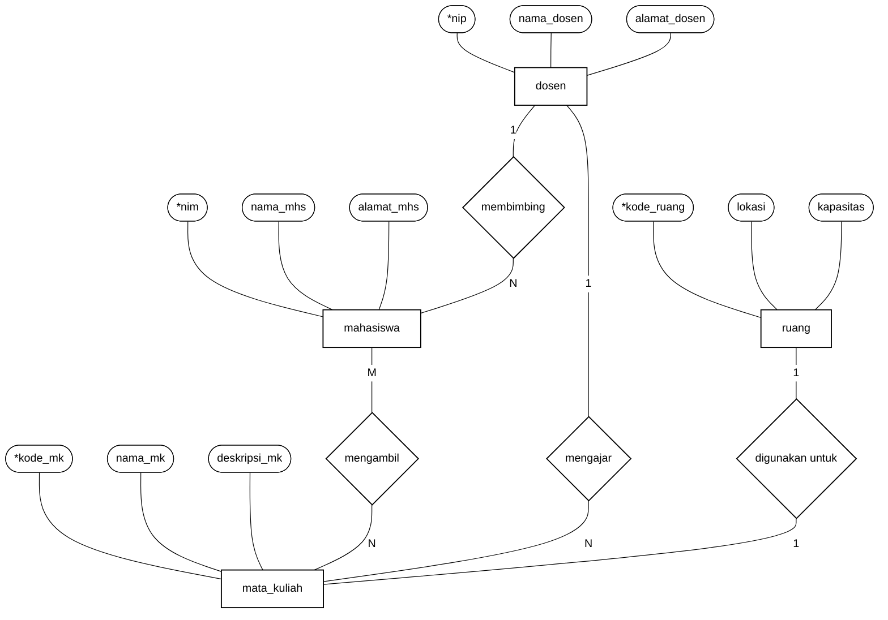
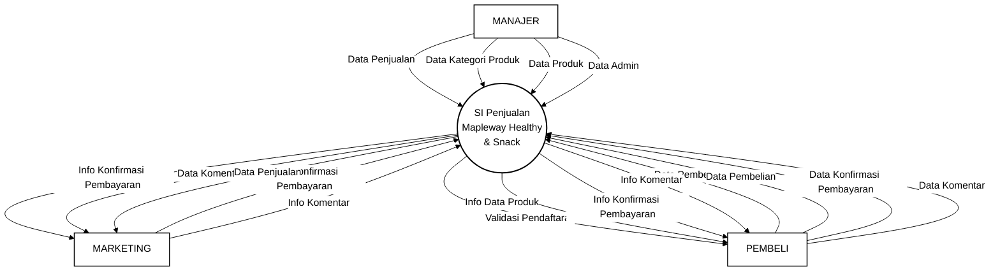
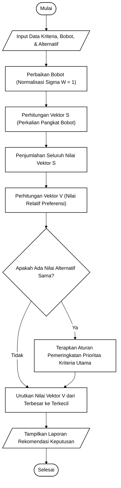
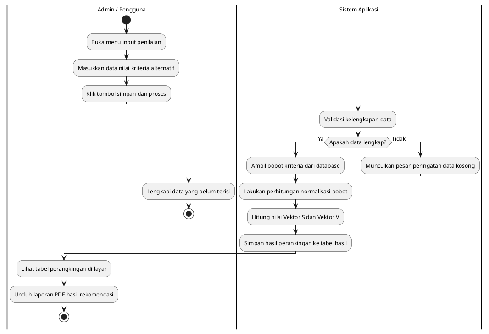
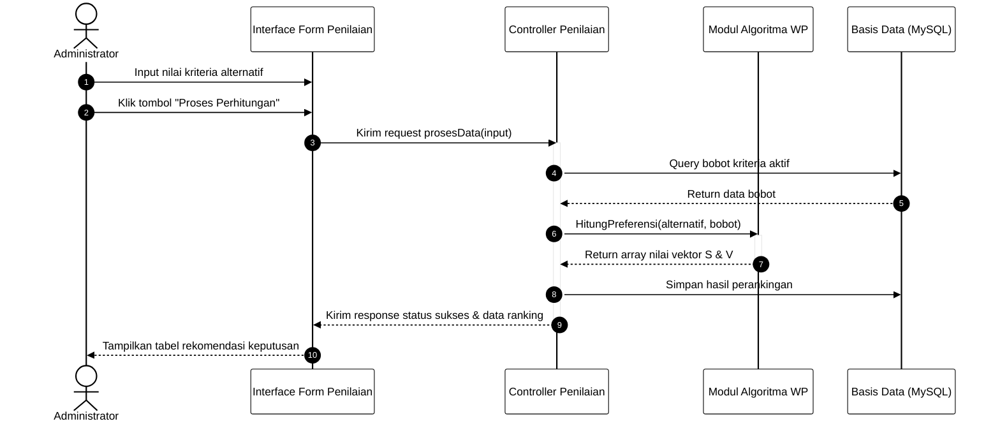

# SOP PEMBUATAN DIAGRAM TEKNIS SKRIPSI INFORMATIKA
## STANDARISASI DIAGRAM-AS-CODE (MERMAID, PLANTUML, DRAW.IO, PYTHON GENERATOR) & VISUAL ZERO-DEFECT

**Document ID:** SOP-DIAGRAM-003  
**Version:** 3.0 (Master Visual Specification & Multi-Tooling Engine)  
**Status:** MANDATORY & STRICT ENFORCEMENT  
**Scope:** Seluruh AI Agent dan pembuatan diagram sistem, ERD, UML, DFD, flowchart, dan arsitektur pada naskah skripsi Informatika.  

---

## 1. TUJUAN DAN 5 PRINSIP UTAMA

SOP ini menetapkan standar teknis dan visual pembuatan diagram skripsi informatika agar **bebas cacat sintaks (*zero-defect*)**, **terbaca sempurna saat dicetak monokrom**, **memiliki keseragaman bentuk sesuai kaidah akademik resmi**, dan **merefleksikan sistem nyata tanpa komponen fiktif**.

```text
+-----------------------------------------------------------------------------------------+
| 1. ACCURATE    : Wajib sesuai arsitektur kode, basis data, dan modul faktual sistem.   |
| 2. MONOCHROME  : Garis hitam solid (#000000), teks hitam, latar dan bidang putih murni. |
| 3. CODE-BASED  : Diprogram dengan sintaks teknis resmi (Mermaid, PlantUML, Draw.io XML, |
|                  atau Python SVG Generator) yang dapat di-render tanpa distorsi visual. |
| 4. NO SHADOW   : Dilarang menggunakan warna dekoratif/gradasi, bayangan (shadow), 3D.   |
| 5. ACADEMIC    : Tipografi Times New Roman, ukuran proporsional (10-12 pt), caption di  |
|                  bawah tengah, lebar maksimal 13.5 cm (pas di margin Word 4-4-3-3 cm).  |
+-----------------------------------------------------------------------------------------+
```

---

## 2. GALERI ACUAN STANDAR VISUAL RESMI (OFFICIAL BENCHMARK GALLERY)

Setiap diagram yang dirancang oleh AI Agent **WAJIB MENYESUAIKAN DIRI** dengan 4 contoh standar visual resmi yang tersimpan di direktori:  
👉 `PEDOMAN_SKIPSI1/ASSETS/DIAGRAM/STANDARD_EXAMPLES/`

```text
ASSETS/DIAGRAM/STANDARD_EXAMPLES/
├── 01_contoh_use_case_diagram.png       <- Standar Visual UML: Use Case Diagram & System Boundary
├── 02_simbol_erd_chen_notation.png      <- Standar Simbol ERD Notasi Peter Chen Akademik
├── 03_contoh_erd_akademik.png           <- Standar Contoh ERD Akademik Lengkap & Kardinalitas
└── 04_contoh_dfd_level_0_konteks.png    <- Standar Visual DFD: Diagram Konteks / Level 0
```

### 2.1 Ringkasan Bedah Visual Contoh Resmi:
1. **Acuan 1: Use Case Diagram (`01_contoh_use_case_diagram.png`)**:
   - Memiliki kotak batas sistem (*System Boundary / Subsystem*) persegi panjang dengan judul di pojok kiri atas bertuliskan `«subsystem» [Nama Sistem/Modul]`.
   - Aktor disajikan dalam bentuk simbol *stick-figure* manusia monokromatik di luar kotak sistem (aktor primer di sisi kiri, aktor sekunder / external system di sisi kanan).
   - Use case berbentuk elips (*horizontal oval*) yang tersusun vertikal rapi di dalam kotak boundary.
   - Garis asosiasi berupa garis lurus tegas tanpa panah (*solid line*) yang menghubungkan aktor dengan elips use case.
2. **Acuan 2: Simbol ERD Notasi Peter Chen (`02_simbol_erd_chen_notation.png`)**:
   - Standar klasik akademik fakultas informatika di Indonesia:
     - **Entitas Kuat (Entity)**: Persegi panjang garis tunggal.
     - **Entitas Lemah (Weak Entity)**: Persegi panjang garis ganda (*double rectangle*).
     - **Relasi (Relationship)**: Belah ketupat garis tunggal (*diamond*).
     - **Relasi Identifikasi (Identifying Relationship)**: Belah ketupat garis ganda (*double diamond*).
     - **Atribut Biasa**: Elips garis tunggal (*single ellipse*).
     - **Atribut Kunci (Key Attribute / Primary Key)**: Elips dengan teks digarisbawahi (*underline*) atau diawali tanda bintang (`*`).
     - **Atribut Multivalue**: Elips garis ganda (*double ellipse*).
     - **Atribut Komposit**: Elips induk bercabang ke sub-elips atribut turunan.
     - **Atribut Derivatif**: Elips garis putus-putus (*dashed ellipse*).
     - **Total Participation**: Garis ganda (*double line*) yang menghubungkan entitas ke relasi.
     - **Kardinalitas**: Notasi eksplisit angka `1` dan `N` (atau `M`) pada setiap ujung relasi.
3. **Acuan 3: Contoh ERD Akademik Lengkap (`03_contoh_erd_akademik.png`)**:
   - Menggambarkan relasi antar-entitas (`mahasiswa`, `dosen`, `mata_kuliah`, `ruang`) dengan atribut melingkari entitas, relasi belah ketupat di tengah, dan penunjuk kardinalitas berarah/terlabel `1:N`, `M:N`, `1:1`.
4. **Acuan 4: DFD Level 0 / Diagram Konteks (`04_contoh_dfd_level_0_konteks.png`)**:
   - Lingkaran proses tunggal di tengah bertuliskan nama sistem secara lengkap.
   - Entitas luar (*external entity*) berbentuk persegi panjang dengan teks huruf kapital tebal (contoh: `MANAJER`, `PEMBELI`, `MARKETING`).
   - Garis alir data (*data flow*) berupa panah terarah bolak-balik dengan teks label dokumen/data yang spesifik dan jelas (bukan panah kosong).

---

## 3. PANDUAN PENGGUNAAN PERKAKAS & PLUGIN (*TOOLING ECOSYSTEM*)

AI Agent dapat memanfaatkan ekosistem perkakas berikut untuk memprogram diagram agar desainnya sesuai dengan sistem mahasiswa:

### 3.1 Draw.io Plugin / Draw.io XML (`.drawio`)
- **Keunggulan**: Menghasilkan diagram monokrom interaktif yang presisi dan dapat diedit kembali oleh mahasiswa atau dosen pembimbing menggunakan aplikasi Draw.io Desktop atau ekstensi VS Code / Antigravity Draw.io Plugin.
- **Standar Format**: Simpan berkas sumber di `ASSETS/DIAGRAM/[nama_diagram].drawio` dan ekspor salinan visualnya menjadi `.png` (300 DPI) atau `.svg`.

### 3.2 Mermaid.js (`.mmd`)
- **Keunggulan**: *Diagram-as-Code* yang dapat langsung di-render di dalam pratinjau Markdown.
- **Konfigurasi Wajib**: Seluruh blok kode Mermaid **WAJIB** diawali direktif tema monokrom baku:
```text
%%{init: {
  'theme': 'base',
  'themeVariables': {
    'primaryColor': '#ffffff',
    'primaryTextColor': '#000000',
    'primaryBorderColor': '#000000',
    'lineColor': '#000000',
    'secondaryColor': '#ffffff',
    'tertiaryColor': '#ffffff',
    'fontFamily': 'Times New Roman, serif',
    'fontSize': '12px'
  }
}}%%
```

### 3.3 PlantUML (`.puml`)
- **Keunggulan**: Sangat stabil untuk Use Case dengan boundary `«subsystem»`, Activity Diagram dengan *swimlanes*, dan Sequence Diagram.
- **Konfigurasi Wajib**:
```plantuml
@startuml
skinparam monochrome true
skinparam shadowing false
skinparam defaultFontName "Times New Roman"
skinparam defaultFontSize 12
skinparam backgroundColor #FFFFFF
skinparam ArrowColor #000000
skinparam BorderColor #000000
@enduml
```

### 3.4 Python Academic Diagram Generator (`AI_program/scripts/render_academic_diagrams.py`)
- Skrip lokal berbasis Python (`matplotlib` / `pillow` / `svgwrite`) yang disediakan untuk menggambar simbol Chen ERD dan DFD secara deterministik dan mengekspornya langsung ke format PNG 300 DPI.

---

## 4. TEMPLATE SINTAKS BAKU PER JENIS DIAGRAM SKRIPSI

### 4.1 Use Case Diagram (Persis Standar Gambar 1)
Menggambarkan interaksi fungsional antara aktor dengan sistem di BAB III.

* **Aturan Visual Wajib:**
  1. Kotak persegi panjang pembatas sistem (*System Boundary*) diberi judul `«subsystem» [Nama Modul / Sistem]` di sudut kiri atas.
  2. Aktor primer berada di sisi kiri kotak; aktor sekunder atau sistem eksternal berada di sisi kanan kotak.
  3. Use case berbentuk elips horizontal, teks kata kerja tindakan (contoh: *Input Nilai Kriteria*, *Proses Algoritma*).
  4. Garis asosiasi berupa garis solid lurus tegas tanpa panah. Relasi `<<include>>` atau `<<extend>>` menggunakan garis putus-putus dengan panah terbuka.

* **Kode PlantUML Baku (Persis Standar Gambar 1):**


* **Kode Mermaid Baku (Pendekatan Subgraph):**


---

### 4.2 Entity Relationship Diagram (ERD Notasi Peter Chen - Persis Gambar 2 & 3)
Standar diagram basis data konseptual skripsi informatika di Indonesia.

* **Aturan Visual Wajib:**
  1. **Entitas**: Kotak persegi panjang dengan nama entitas huruf kecil/tunggal (contoh: `mahasiswa`, `dosen`, `mata_kuliah`).
  2. **Relasi**: Belah ketupat (*diamond*) dengan nama kata kerja di dalamnya (contoh: `membimbing`, `mengambil`, `mengajar`).
  3. **Atribut**: Elips yang dihubungkan dengan garis ke entitas induknya. Atribut kunci (*primary key*) wajib diawali tanda bintang atau digarisbawahi (contoh: `*nim`, `*kode_mk`).
  4. **Kardinalitas**: Dituliskan angka `1` dan `N` (atau `M`) pada garis penghubung di dekat entitas/relasi.

* **Kode Mermaid Baku (Simulasi Notasi Chen Menggunakan Custom Node Shapes):**


---

### 4.3 Data Flow Diagram (DFD) — Diagram Konteks & Berjenjang (Persis Standar Gambar 4)
Menjelaskan aliran data sistem secara fungsional.

* **Aturan Visual Wajib:**
  1. **Diagram Konteks (Level 0)**:
     - Tepat satu lingkaran/proses di tengah yang mewakili keseluruhan sistem (contoh: `SI Penjualan Mapleway Healthy & Snack` atau `Sistem Pendukung Keputusan Rekrutmen Guru`).
     - Seluruh entitas eksternal berupa kotak persegi panjang dengan teks huruf kapital (contoh: `MANAJER`, `MARKETING`, `PEMBELI`).
     - Aliran data digambarkan dengan garis berpanah yang memiliki label nama dokumen/data yang jelas.
  2. **DFD Level 1 & Level 2**:
     - Proses diberi nomor terurut: `1.0`, `2.0`, `3.0`, dst.
     - Simpanan data (*Data Store*) digambarkan dengan dua garis horizontal sejajar terbuka (`= D1 tbl_pelamar`).
     - **Aturan Konservasi Data**: Dilarang menghubungkan entitas luar langsung ke entitas luar lainnya, dan dilarang menghubungkan data store langsung ke data store tanpa melewati proses.

* **Kode Mermaid Baku (Diagram Konteks / Level 0 Persis Gambar 4):**


---

### 4.4 Flowchart Algoritma / Diagram Alir Komputasi (Standar ANSI/ISO)
Digunakan pada BAB III dan BAB IV untuk merinci langkah kalkulasi matematis (contoh: tahapan normalisasi, pemangkatan bobot, dan perankingan preferensi).



---

### 4.5 Activity Diagram dengan Swimlane (UML)
Menunjukkan pembagian peran dan aktivitas antara pengguna (*user*) dan sistem.



---

### 4.6 Sequence Diagram (UML)
Menampilkan interaksi berurutan antar-objek perangkat lunak.



---

## 5. ATURAN ANTI-CACAT SINTAKS (*ZERO-DEFECT SYNTAX RULES*)

Untuk mencegah kegagalan ekspor atau kerusakan tata letak dokumen Word:
1. **Wajib Membungkus Label Khusus dengan Tanda Petik**:
   - Selalu gunakan `["Teks (Keterangan)"]` jika memuat kurung atau karakter khusus.
2. **Kerapian Garis Hubung**:
   - Atur posisi node agar garis panah tidak saling memotong secara semrawut (*avoid messy line crossing*).
3. **Proporsi Dimensi Gambar pada Kertas A4 (Smart Image Sizing)**:
   - **Diagram Landscape (lebar ≥ tinggi)**: Lebar maksimal **13.5 cm**, tinggi maksimal **11.0 cm**.
   - **Diagram Portrait (tinggi > lebar)**: Tinggi maksimal **12.0 cm** agar tidak terdorong ke halaman baru dan terpisah dari caption.
   - **Anti-Orphan Caption**: Setiap gambar wajib dipasangkan atribut `keep_with_next = True` pada paragraf Word.
   - **Format Caption Baku**: Ditempatkan di **bawah tengah** gambar dengan format: **Gambar X.X** (Bold) dilanjutkan spasi ganda dan Judul Gambar (Reguler).
4. **Kualitas Resolusi**: Format PNG minimum 300 DPI atau format Vektor SVG murni.

---

## 6. QUALITY CONTROL CHECKLIST SEBELUM DIAGRAM MASUK NASKAH

Sebelum diagram disematkan ke draf BAB III, BAB IV, atau BAB V:
- [ ] Diagram sesuai 100% dengan salah satu contoh visual resmi di `ASSETS/DIAGRAM/STANDARD_EXAMPLES/`.
- [ ] Latar belakang putih bersih (#FFFFFF), garis hitam tegas (#000000), tanpa warna-warni dekoratif dan tanpa efek bayangan (*no drop-shadow*).
- [ ] Seluruh nama aktor, use case, entitas, dan proses konsisten dengan [CONTEXT_SKRIPSI.txt](CONTEXT_SKRIPSI.txt).
- [ ] ERD memuat Primary Key (*underline* atau `*`) dan label rasio kardinalitas (`1:1`, `1:N`, `M:N`).
- [ ] DFD mematuhi aturan konservasi aliran data (tidak ada *black hole* atau *miracle*).
- [ ] Terdapat narasi paragraf akademik pengantar dan penjelas diagram di dalam naskah skripsi.
